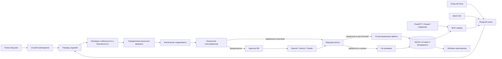

# План проекта Optium+ File Manager

Версия плана: 1.0  
Дата: 8 октября 2026 года  
Название решения: Optium+ File Manager

## 1. Идея проекта

Программа автоматически принимает файлы из папки загрузок, других выбранных папок, окна приложения, HTTP API и ИИ-агентов. Затем она определяет реальный формат и смысл содержимого, выбирает категорию, безопасно перемещает файл и сохраняет историю операции.

Имя и расширение используются только как один из признаков. Например, файл `Батыр` без расширения, внутри которого находится код C#, должен попасть в `Программирование/CSharp`. Файл `photo.jpg`, внутри которого находится не JPEG, не должен автоматически считаться изображением.

## 2. Итоговый сценарий пользователя

1. Пользователь один раз выбирает входящие папки, например `Загрузки` и `Рабочий стол`.
2. Программа запускается вместе с Windows и работает в фоне.
3. Новый файл появляется во входящей папке.
4. Программа ждёт завершения скачивания или копирования.
5. Файл проверяется, хешируется, анализируется и классифицируется.
6. При высокой уверенности файл сразу перемещается в нужную папку.
7. При низкой уверенности файл попадает в `На проверку`, где пользователь подтверждает категорию.
8. Решение и все операции записываются в журнал. Перемещение можно отменить.
9. Внешние ИИ-агенты могут через MCP или HTTP загрузить новый файл, посмотреть статус, получить разрешённый файл или запросить повторный анализ.

## 3. Главные архитектурные решения

### 3.1. Два разных вида интеграции с ИИ

Нужно разделить две задачи:

1. **ИИ как анализатор.** OpenAI, Gemini или Claude получает извлечённый текст/изображение и возвращает классификацию в JSON.
2. **ИИ как внешний клиент.** ChatGPT, Claude, Antigravity или другой агент вызывает инструменты проекта через MCP: загружает файл, получает список, проверяет статус и скачивает разрешённый результат.

Это предотвращает путаницу. Модель-анализатор не получает прямой доступ к диску и сама не перемещает файлы. Все операции с файловой системой выполняет только проект после проверки пути, прав и результата анализа.

`Antigravity` следует считать агентской средой, а не ещё одной моделью-классификатором. Для неё основной способ подключения — MCP или добавление папки проекта в её workspace. Официальная документация Antigravity описывает доступ агентов к папкам проекта и поддержку MCP.

### 3.2. Локальный анализ обязателен

Программа должна работать без интернета и API-ключей. Облачный ИИ вызывается только тогда, когда локальные правила не дали достаточно уверенный результат или когда пользователь явно включил глубокий анализ.

Преимущества:

- меньше расходов на API;
- быстрее сортируются очевидные файлы;
- приватные файлы можно не отправлять в облако;
- отказ одного провайдера не останавливает весь проект.

### 3.3. Фиксированные категории, свободные теги

ИИ не должен самостоятельно создавать произвольные пути. Он выбирает только `categoryId` и `subcategoryId` из разрешённого справочника. Свободные данные, например тема `телеграм-бот`, сохраняются как теги и описание.

Это исключает мусорные папки, ошибки в названиях и попытки выхода за корневую директорию.

## 4. Общая архитектура



## 5. Структура рабочих папок

```text
OptiumPlusFileManagerData/
├── Inbox/                 # файлы, принятые через приложение/API
├── Processing/            # временная рабочая зона
├── Sorted/
│   ├── Programming/
│   │   ├── CSharp/
│   │   ├── Python/
│   │   ├── Java/
│   │   ├── JavaScript/
│   │   └── OtherCode/
│   ├── Documents/
│   │   ├── Study/
│   │   ├── Work/
│   │   ├── Finance/
│   │   └── Other/
│   ├── Images/
│   ├── Audio/
│   ├── Video/
│   ├── Archives/
│   ├── Applications/
│   └── Other/
├── Review/                # нужна ручная проверка
├── Quarantine/            # опасный или подозрительный файл
├── Errors/                # обработка завершилась ошибкой
└── .data/
    ├── filesorter.db
    ├── logs/
    └── temp/
```

Путь назначения строит приложение. ИИ возвращает идентификатор категории, но не абсолютный путь.

## 6. Полный конвейер обработки файла

### Шаг 1. Приём события

Источники:

- одна или несколько наблюдаемых папок;
- перетаскивание в окно;
- ручной выбор файла;
- `POST /api/files`;
- MCP-инструмент для локального файла или заявка на HTTP-загрузку.

Каждому принятому файлу назначается UUID и создаётся запись со статусом `Detected`.

### Шаг 2. Ожидание завершения записи

Одного события `FileSystemWatcher` недостаточно: оно может прийти до завершения скачивания. Поэтому программа:

1. проверяет существование файла;
2. несколько раз сравнивает размер и время изменения;
3. пытается открыть файл без совместного доступа на запись;
4. игнорирует временные расширения `.part`, `.crdownload`, `.tmp`, `.download`;
5. дополнительно раз в несколько минут сверяет содержимое папки, чтобы подобрать пропущенные события.

После этого статус меняется на `Ready`.

### Шаг 3. Безопасная первичная проверка

- нормализация полного пути;
- проверка, что путь находится внутри разрешённой входящей папки;
- лимит размера;
- запрет выполнения принятого файла;
- вычисление SHA-256;
- поиск точного дубликата;
- проверка цифровой сигнатуры формата по первым байтам;
- для архивов — лимит числа файлов, суммарного распакованного размера и глубины вложенности;
- при необходимости вызов антивирусной проверки Windows.

Подозрительный файл получает статус `Quarantined` и не отправляется в ИИ.

### Шаг 4. Определение реального формата

Сигналы анализируются в следующем порядке:

1. сигнатура содержимого (`magic bytes`);
2. MIME-тип;
3. структура контейнера, например ZIP/OpenXML;
4. кодировка и доля печатного текста;
5. расширение;
6. имя файла.

Расширение не имеет решающего приоритета. Если расширение противоречит сигнатуре, файл отправляется на дополнительную проверку или в карантин.

### Шаг 5. Извлечение содержимого

| Тип | Что извлекается |
|---|---|
| Исходный код и текст | полный текст для небольших файлов, части начала/середины/конца для больших |
| PDF | текст страниц, заголовок, число страниц; OCR для сканов |
| DOCX | абзацы, заголовки, таблицы и свойства документа |
| XLSX/CSV | названия листов, заголовки колонок, ограниченная выборка строк |
| PPTX | заголовки и текст слайдов |
| Изображения | размеры, метаданные, OCR-текст, визуальное описание при разрешённом ИИ |
| Аудио/видео | технические метаданные; транскрипция как дополнительная функция |
| Архивы | безопасный список содержимого и анализ разрешённых вложений |
| Исполняемые файлы | метаданные, версия, подпись; запуск запрещён |

Зашифрованный, повреждённый или неподдерживаемый файл получает статус `NeedsReview` с понятной причиной.

### Шаг 6. Локальная классификация

Для программного кода учитываются синтаксические признаки, а не имя:

- C#: `using`, `namespace`, классы, атрибуты, типы .NET, структура методов;
- Python: `def`, `import`, `from`, отступы, декораторы;
- Java: `package`, `import`, классы, типичные объявления;
- JavaScript/TypeScript: `const`, `let`, `function`, `import/export`, аннотации типов;
- HTML/CSS/SQL и другие языки — по собственным сигнатурам.

Для документов применяются ключевые слова, метаданные, заголовки и правила пользователя. Например, наличие терминов задания, предмета и группы может дать категорию `Documents/Study`.

Локальный классификатор возвращает несколько кандидатов и оценку уверенности от 0 до 1.

### Шаг 7. Вызов ИИ при необходимости

ИИ вызывается, если:

- локальная уверенность ниже заданного порога, например `0.85`;
- два классификатора дали близкие результаты;
- нужно определить смысл документа или изображения;
- пользователь нажал «Глубокий анализ».

Модели передаются:

- безопасные метаданные;
- определённый реальный формат;
- извлечённый текст или ограниченные части;
- список допустимых категорий;
- результаты локального анализа;
- инструкция вернуть только JSON заданной схемы.

Пример единого результата:

```json
{
  "categoryId": "programming",
  "subcategoryId": "csharp",
  "detectedFileType": "source_code",
  "detectedLanguage": "CSharp",
  "topic": "console application",
  "summary": "Программа считывает числа и вычисляет среднее значение",
  "confidence": 0.97,
  "suggestedExtension": ".cs",
  "tags": ["college", "algorithm", "console"],
  "reasonCodes": ["CSHARP_NAMESPACE", "DOTNET_USING", "CLASS_DECLARATION"]
}
```

Ответ проверяется по JSON Schema. Неизвестная категория, путь вместо ID, лишние поля или низкая уверенность отклоняются.

### Шаг 8. Решение и перемещение

Правила:

- `confidence >= 0.85` — автоматическое перемещение;
- `0.60 <= confidence < 0.85` — очередь ручного подтверждения;
- `confidence < 0.60` — `Review/Unknown`;
- конфликт имени — добавление безопасного номера или короткого фрагмента хеша;
- расширение автоматически не меняется в первой версии; исправление расширения предлагается пользователю;
- перемещение выполняется атомарно, когда это возможно;
- до завершения операции запись в базе имеет статус `Moving`;
- после сбоя приложение продолжает незавершённые задания при следующем запуске.

### Шаг 9. История и отмена

Для каждого действия хранятся исходный путь, новый путь, время, хеш, классификация, использованный провайдер и причина решения. Команда «Отменить» возвращает файл назад, если место свободно и хеш совпадает.

## 7. Подключение OpenAI, Gemini и Claude

### 7.1. Общий интерфейс

В коде вводится интерфейс:

```csharp
public interface IAiFileAnalyzer
{
    string ProviderId { get; }
    Task<AiClassification> AnalyzeAsync(
        FileAnalysisInput input,
        CancellationToken cancellationToken);
}
```

Реализации:

- `OpenAiFileAnalyzer`;
- `GeminiFileAnalyzer`;
- `ClaudeFileAnalyzer`;
- позднее `LocalModelFileAnalyzer` для локальной модели;
- `NoAiFileAnalyzer` для полностью локального режима.

Название модели хранится в настройках и не зашивается в код. Это позволяет менять модели без пересборки программы.

### 7.2. Режимы выбора провайдера

- `Off` — только локальный анализ;
- `OpenAI`, `Gemini`, `Claude` — фиксированный провайдер;
- `Auto` — основной провайдер плюс резервные;
- `Compare` — запрос двум провайдерам только для демонстрации и проверки качества.

В режиме `Auto` применяется тайм-аут, ограниченное число повторов и переход к следующему провайдеру. Ошибка API никогда не приводит к потере файла: он попадает в очередь ручной проверки.

### 7.3. Работа с файлами у провайдеров

- OpenAI Responses API принимает текстовые, графические и файловые входы; OpenAI также поддерживает MCP-инструменты.
- Gemini Files API позволяет загружать документы и медиа для анализа.
- Claude Files API позволяет загрузить файл, получить `file_id` и использовать его в Messages API; для неподдерживаемых офисных форматов текст предварительно извлекает сам проект.

По умолчанию в облако отправляется извлечённое содержимое, а не оригинал. Оригинал отправляется только для поддерживаемых форматов и только при включённой настройке.

## 8. MCP и HTTP для внешних ИИ-агентов

### 8.1. Зачем нужны оба интерфейса

MCP удобен для агента, а HTTP multipart лучше подходит для передачи больших бинарных файлов. Поэтому MCP-команда создаёт заявку или указывает локальный путь, а фактическая удалённая загрузка выполняется через одноразовый HTTP URL.

### 8.2. MCP-инструменты первой версии

| Инструмент | Назначение | Право |
|---|---|---|
| `submit_local_file` | принять файл из разрешённой локальной папки | запись |
| `create_upload_ticket` | выдать одноразовый URL для загрузки | запись |
| `put_text_file` | создать небольшой текстовый файл | запись |
| `list_files` | показать файлы и фильтры по статусу | чтение |
| `get_file` | вернуть метаданные, категорию, описание и статус | чтение |
| `get_download_link` | выдать короткоживущую ссылку на разрешённый файл | чтение |
| `request_analysis` | запустить или повторить анализ | запись |
| `suggest_category` | предложить категорию без перемещения | чтение |
| `approve_classification` | подтвердить решение из очереди проверки | запись |
| `move_file` | переместить только в разрешённую категорию | запись с подтверждением |

Удаление файлов через MCP в первой версии не предоставляется.

### 8.3. REST API

```text
POST   /api/files                    загрузить файл
GET    /api/files                    получить список
GET    /api/files/{id}               метаданные и статус
GET    /api/files/{id}/content       скачать разрешённый файл
POST   /api/files/{id}/analyze       повторить анализ
POST   /api/files/{id}/approve       подтвердить категорию
GET    /api/jobs/{id}                состояние задания
GET    /api/providers/health         доступность провайдеров
```

Локально API слушает только `127.0.0.1`. Для удалённого доступа обязательны HTTPS, короткоживущие токены, разграничение прав и журналирование.

### 8.4. Подключение конкретных клиентов

- **ChatGPT:** подключение собственного MCP-сервера как плагина с инструментами чтения и записи; локальный сервер можно подключать через защищённый туннель, если эта возможность доступна в используемом аккаунте.
- **OpenAI API:** Responses API вызывает удалённый MCP-сервер или локальный сервер через защищённый туннель.
- **Claude API:** MCP connector вызывает инструменты удалённого HTTPS-сервера; для локальной версии используется клиентская MCP-интеграция.
- **Antigravity:** локальный `stdio` MCP или HTTP/SSE-сервер настраивается в workspace; также можно дать Antigravity доступ только к специально выделенной папке проекта.
- **Gemini:** используется как анализатор через API; доступ агента к файлам добавляется через тот же MCP/HTTP слой, если клиент поддерживает инструменты.

## 9. Структура решения C#/.NET

```text
OptiumPlusFileManager.sln
├── src/
│   ├── OptiumPlusFileManager.Domain/          # сущности, статусы, категории, правила
│   ├── OptiumPlusFileManager.Application/     # конвейер, очередь, интерфейсы сервисов
│   ├── OptiumPlusFileManager.Infrastructure/  # SQLite, извлечение, файловая система, AI API
│   ├── OptiumPlusFileManager.Worker/          # наблюдение за папками и фоновые задания
│   ├── OptiumPlusFileManager.Api/             # REST и MCP
│   └── OptiumPlusFileManager.Desktop/         # Windows-интерфейс и трей
└── tests/
    ├── OptiumPlusFileManager.UnitTests/
    └── OptiumPlusFileManager.IntegrationTests/
```

Для учебного проекта это остаётся одним решением Visual Studio. Проекты разделены по ответственности, поэтому интерфейс, API и ИИ-провайдеры можно менять независимо от правил сортировки.

## 10. Основные сущности и база SQLite

### Таблица `Files`

- `Id`;
- `OriginalName`;
- `OriginalPath`;
- `CurrentPath`;
- `SizeBytes`;
- `Sha256`;
- `DetectedMimeType`;
- `DetectedFileType`;
- `DetectedLanguage`;
- `CategoryId`;
- `SubcategoryId`;
- `Confidence`;
- `Summary`;
- `Status`;
- `SourceType`;
- `CreatedAtUtc`;
- `CompletedAtUtc`.

### Таблица `AnalysisResults`

Хранит локальный результат, ответ каждого ИИ-провайдера, версию классификатора, длительность и коды причин. Полный текст файла в базе не сохраняется.

### Таблица `FileEvents`

Неизменяемый журнал состояний: `Detected`, `Ready`, `Extracting`, `Classifying`, `NeedsReview`, `Moving`, `Completed`, `Failed`, `Quarantined`, `Reverted`.

### Таблицы настроек

- `WatchFolders`;
- `Categories`;
- `SortingRules`;
- `ProviderSettings` без секретных ключей.

API-ключи хранятся в Windows Credential Manager или переменных среды, но не в SQLite, `appsettings.json`, Git и логах.

## 11. Интерфейс приложения

### Главная страница

- число файлов в очереди;
- обработанные сегодня;
- файлы на проверке;
- ошибки;
- выбранный ИИ-провайдер и его состояние;
- последние операции.

### Экран «Входящие папки»

- добавление и удаление наблюдаемых папок;
- включение автозапуска;
- настройка рекурсивного просмотра;
- исключения по пути, маске и размеру.

### Экран «На проверку»

- имя и безопасный просмотр;
- определённый тип и язык;
- краткое описание;
- предложенная категория;
- уверенность и причины;
- кнопки «Подтвердить», «Изменить», «Не сортировать».

Исправление пользователя превращается в локальное правило. Так система постепенно лучше учитывает личную структуру папок без переобучения модели.

### Экран «История»

- фильтры по дате, категории, статусу и источнику;
- открытие папки;
- повторный анализ;
- отмена перемещения;
- экспорт журнала в CSV для демонстрации преподавателю.

### Экран «ИИ и приватность»

- режим `Off/Auto/Provider`;
- проверка API-ключа;
- основной и резервные провайдеры;
- разрешённые типы файлов;
- максимальный размер;
- переключатель отправки оригинала;
- месячный лимит запросов/расходов;
- локальный режим для приватных папок.

## 12. Надёжность и безопасность

Обязательные правила:

- никогда не выполнять и не подключать принятые файлы как библиотеку;
- не доверять имени, расширению, MIME от клиента и ответу ИИ;
- проверять реальный полный путь до каждой операции;
- не позволять `..`, абсолютные пути и симлинки вывести операцию за разрешённый корень;
- сначала копировать/перемещать во временный файл, затем атомарно переименовывать;
- сохранять оригинал до успешного завершения;
- ограничивать размер файла, длительность анализа и число повторов;
- защищаться от ZIP-bomb и рекурсивных архивов;
- не писать содержимое, API-ключи и персональные данные в лог;
- все изменяющие MCP-инструменты помечать как операции записи;
- чувствительные действия агента выполнять с подтверждением;
- использовать отдельные токены с минимальными правами;
- при сбое сети сохранять задание и продолжать локально.

Отдельный локальный фильтр должен искать вероятные секреты: приватные ключи, токены, `.env`, пароли и строки подключения. Такие данные по умолчанию не отправляются внешнему ИИ.

## 13. Этапы реализации

### Этап 0. Зафиксировать правила — 0.5–1 день

Результат:

- окончательный список категорий;
- входящие и выходные папки;
- поддерживаемые форматы первой версии;
- пороги уверенности;
- политика приватности.

### Этап 1. Надёжное локальное ядро — 2–3 дня

Работы:

- разделить текущий код на Domain/Application/Infrastructure;
- добавить несколько наблюдаемых папок;
- очередь, ожидание завершения записи, хеширование;
- определение формата по содержимому;
- безопасное перемещение, конфликты и отмена.

Критерий готовности: новый файл из `Загрузки` стабильно проходит конвейер без ИИ и не теряется после перезапуска.

### Этап 2. Извлечение и анализ содержимого — 3–5 дней

Работы:

- текст и исходный код;
- PDF, DOCX, XLSX, PPTX;
- OCR изображений;
- безопасный просмотр архивов;
- локальный классификатор языков программирования и документов.

Критерий готовности: файл `Батыр` без расширения с C#-кодом попадает в `Programming/CSharp`; документ с учебным заданием определяется как `Documents/Study`.

### Этап 3. SQLite, история и восстановление — 2–3 дня

Работы:

- таблицы файлов, результатов и событий;
- восстановление незавершённых заданий;
- дубликаты по SHA-256;
- отмена операции;
- структурные логи.

Критерий готовности: после аварийного закрытия приложение не дублирует и не теряет задания.

### Этап 4. Новый интерфейс — 2–4 дня

Работы:

- панель состояния;
- настройки папок;
- очередь ручной проверки;
- история и отмена;
- настройки приватности и автозапуска.

Критерий готовности: все ежедневные действия выполняются без редактирования конфигурационных файлов.

### Этап 5. ИИ-провайдеры — 3–5 дней

Порядок:

1. общий `IAiFileAnalyzer` и JSON Schema;
2. один основной провайдер;
3. второй и третий адаптер;
4. режим `Auto`, тайм-ауты, резервирование и лимиты;
5. сравнение качества на одном наборе файлов.

Критерий готовности: отключение или ошибка любого API не останавливает сортировку; ответ каждого провайдера проходит одинаковую валидацию.

### Этап 6. REST API и MCP — 3–5 дней

Работы:

- HTTP API загрузки и статуса;
- авторизация и одноразовые ссылки;
- локальный MCP `stdio`;
- MCP через Streamable HTTP;
- конфигурации для Antigravity;
- проверка подключения OpenAI/ChatGPT и Claude там, где аккаунт поддерживает соответствующий интерфейс.

Критерий готовности: агент может добавить файл, получить ID, дождаться результата и запросить разрешённый файл, не имея произвольного доступа к диску.

### Этап 7. Проверка, упаковка и материалы защиты — 2–3 дня

Результат:

- автономный Windows x64 `.exe`;
- демонстрационный набор файлов;
- инструкция пользователя;
- техническая документация;
- диаграмма архитектуры и базы данных;
- сценарий показа на 5–7 минут;
- таблица сравнения локальной и ИИ-классификации.

### Оценка объёма

- пригодный для защиты MVP: примерно 8–12 рабочих дней;
- полная версия с тремя провайдерами и MCP: примерно 18–25 рабочих дней.

Сначала следует довести до готовности этапы 0–4. ИИ и MCP добавляются поверх рабочего локального ядра.

## 14. Набор обязательных проверок

1. Файл `Батыр` без расширения содержит C# и определяется как C#.
2. Файл `.txt` содержит Python и определяется как Python, потому что `.txt` — слабый признак.
3. Файл `.jpg` с ZIP-сигнатурой не считается изображением.
4. Большой файл сортируется без загрузки всего содержимого в память.
5. Файл, который ещё скачивается, не перемещается раньше времени.
6. Два одинаковых файла распознаются по SHA-256.
7. Два разных файла с одинаковым именем сохраняются оба.
8. Повреждённый PDF попадает в `Errors` или `Review`, а не теряется.
9. Архив с опасным путём `../` не распаковывается за рабочую папку.
10. При отсутствии интернета локальная классификация продолжает работать.
11. При неверном ответе ИИ JSON отклоняется.
12. При низкой уверенности файл не перемещается автоматически.
13. После перезапуска незавершённое задание продолжается один раз.
14. Отмена возвращает правильный файл и проверяет его хеш.
15. MCP-токен только для чтения не может загрузить или переместить файл.

## 15. Границы проекта

Фраза «анализировать все файлы» означает поддержку заранее определённых семейств и безопасный запасной сценарий. Невозможно гарантированно понять произвольный закрытый, зашифрованный, повреждённый или неизвестный бинарный формат. Для таких случаев правильное поведение — не угадывать, а поместить файл в `Review` и объяснить причину.

В первую защищаемую версию входят:

- исходный код и обычный текст;
- PDF и основные офисные документы;
- изображения с OCR;
- архивы на уровне списка содержимого;
- метаданные аудио, видео и программ;
- один работающий ИИ-провайдер плюс архитектура для остальных;
- локальный MCP и HTTP API.

Транскрипция длинного аудио/видео, семантический анализ каждого кадра, облачный многопользовательский сервер и обучение собственной нейросети являются расширениями после основной версии.

## 16. Когда проект считается полностью готовым

Проект готов, если одновременно выполнены условия:

- автоматически отслеживаются выбранные папки;
- тип определяется по содержимому, а не только по имени;
- ни один сбой анализатора не приводит к потере файла;
- неоднозначные решения требуют ручного подтверждения;
- история и отмена работают после перезапуска;
- хотя бы один облачный провайдер реально подключён;
- остальные провайдеры подключаются через общий интерфейс без изменения ядра;
- MCP-клиент может безопасно загрузить файл и получить результат;
- секреты не находятся в исходном коде и логах;
- есть автономная сборка, инструкция и демонстрационный сценарий.

## 17. Официальные основания для интеграций

- [OpenAI Responses API: файловые входы и инструменты](https://developers.openai.com/api/reference/cli/resources/responses/methods/create)
- [OpenAI: подключение MCP к Responses API и локальный защищённый туннель](https://developers.openai.com/api/docs/guides/tools-connectors-mcp)
- [OpenAI: собственный MCP-сервер в ChatGPT с read/write-инструментами](https://developers.openai.com/api/docs/guides/custom-mcp-server)
- [Gemini Files API](https://ai.google.dev/gemini-api/docs/files)
- [Claude Files API](https://platform.claude.com/docs/en/build-with-claude/files)
- [Claude MCP connector](https://platform.claude.com/docs/en/agents-and-tools/mcp-connector)
- [Antigravity: MCP](https://antigravity.google/docs/mcp)
- [Antigravity: проекты и доступ агента к выбранным папкам](https://antigravity.google/docs/getting-started)
