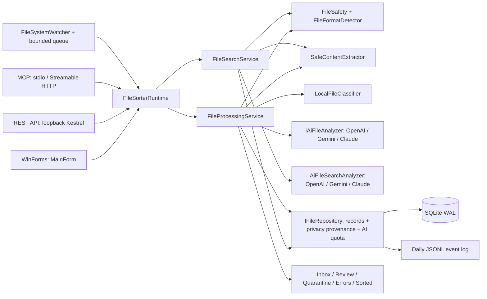
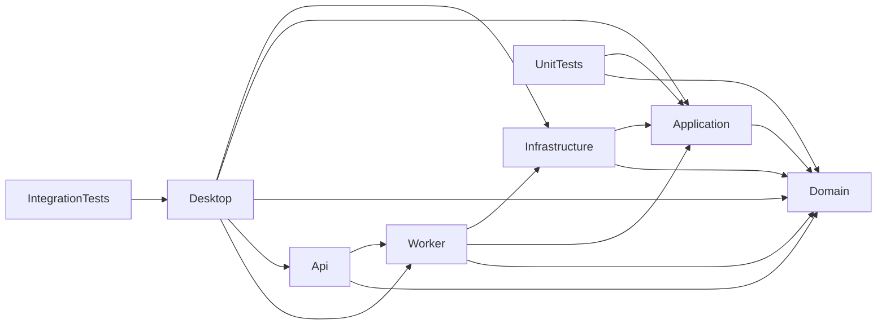
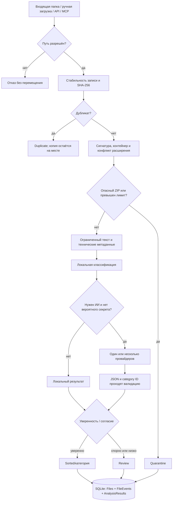
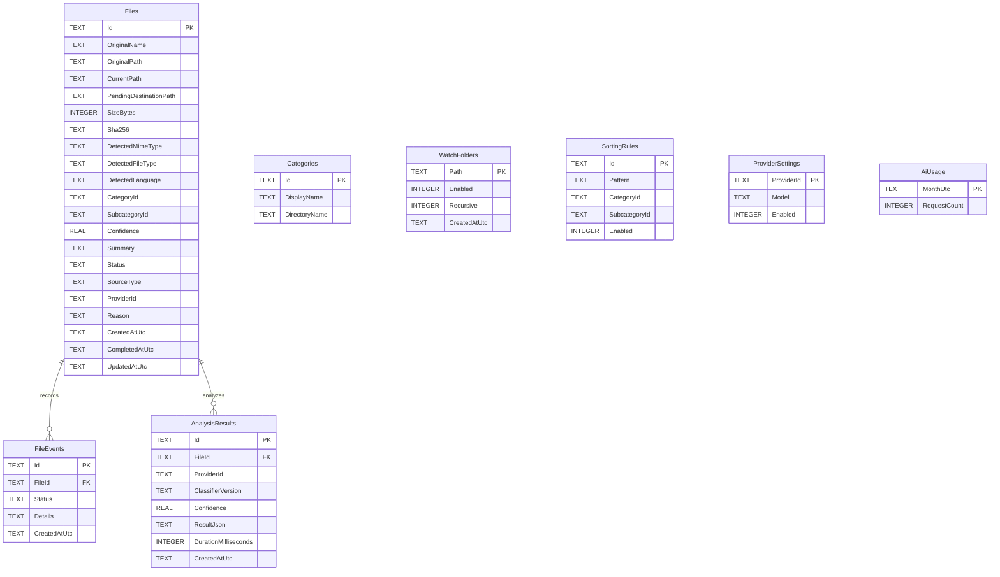

# Архитектура и база данных

## Слои приложения



WinForms, REST, MCP и наблюдатель вызывают один runtime и один конвейер. AI-адаптеры не имеют доступа к файловой системе: они получают разрешённый ограниченный текст и технические метаданные и возвращают классификацию по фиксированной схеме. Перед вызовом применяются секрет-фильтр, политика типов/локальных папок и месячная квота. Только `FileProcessingService` выбирает путь назначения и перемещает файл.

Вкладка **ИИ-поиск** вызывает `FileSearchService`. Он только читает файлы из `Sorted`, безопасно извлекает содержимое и проверяет все файлы. Холодный проход читает до четырёх файлов одновременно; извлечённый текст и заранее рассчитанные поисковые термины хранятся в ограниченном LRU-кэше процесса с привязкой к пути, размеру и времени изменения файла. Поэтому повторные запросы не запускают повторно извлечение и OCR для неизменившихся файлов. Список файлов из SQLite о приватном происхождении загружается один раз и обновляется после изменения политики или завершения сортировки. Для указанного языка сначала ищется в его категории, после чего — при отсутствии совпадений — проверяются остальные категории. Если облачный режим включён, `IAiFileSearchAnalyzer` проверяет разрешённые кандидаты порциями до 16 файлов и останавливается при совпадении или исчерпании квоты. Ответ содержит только проверяемые ID кандидатов. Абсолютные пути остаются в приложении. При сборе кандидатов учитываются allowlist, секреты, визуальный opt-in для изображений и исходные пути приватных файлов из SQLite.

Проекты решения разделяют зависимости по ответственности. Стрелка означает, что исходный проект ссылается на целевой.



Основные каталоги исходного кода:

- `Domain/` — записи файлов, статусы и фиксированный `CategoryCatalog`.
- `Application/` — интерфейсы репозитория, извлечения, классификации и анализа.
- `Infrastructure/` — SQLite, файловая безопасность, детектор форматов, локальная классификация, извлечение и AI-адаптеры.
- `Worker/` — runtime-конвейер, восстановление заданий и наблюдение за входящими папками.
- `Api/` — REST, одноразовые ссылки, MCP-инструменты и авторизация.
- `MainForm.cs`, `Program.cs` — проект `OptiumPlusFileManager.Desktop`: оконный интерфейс и запуск приложения.
- `tests/OptiumPlusFileManager.UnitTests/` и `tests/OptiumPlusFileManager.IntegrationTests/` — отдельные наборы unit- и интеграционных проверок.

## Конвейер файла



Порог автосортировки по умолчанию — `0.85`, ручной проверки — `0.60`. Сигнатура опасного или несовпадающего формата проверяется до облачного запроса. При конфликте расширения файл уходит в Review; при превышении безопасных ограничений ZIP — в Quarantine. Неизвестный формат не угадывается.

## Состояния и аварийное восстановление

Перед файловой операцией база получает `Status=Moving` и `PendingDestinationPath`. После перезапуска приложение проверяет текущий и зарезервированный пути, сверяет SHA-256 и выводит статус из фактической папки. При копировании между томами временный файл создаётся в папке назначения; оригинал удаляется только после сверки хешей копии и источника. Блокировки по полному пути предотвращают параллельную обработку несколькими процессами приложения.

Если резервный путь содержит другой хеш, приложение не присваивает эту запись чужому файлу и не удаляет его. Статус становится `Failed`, а конфликт можно разобрать вручную. Операции с SQLite не запускают компенсирующее перемещение при ошибке базы; последняя подтверждённая контрольная точка остаётся доступна для следующего старта.

## Размещение данных

```text
%LOCALAPPDATA%\OptiumPlusFileManager\
├── Inbox/                 # шлюз ручных, HTTP и MCP-загрузок
├── Processing/            # зарезервировано для рабочего процесса
├── Review/                # ручная проверка
├── Quarantine/            # подозрительные архивы и слишком большие файлы
├── Errors/                # файлы с ошибками, если их можно безопасно переместить
└── .data/
    ├── filesorter.db      # SQLite, WAL
    ├── locks/              # межпроцессные блокировки путей
    └── logs/               # ежедневный JSONL

Рабочий стол\OptiumPlusFileManagerData\Sorted/
```

Новый профиль находится в `%LOCALAPPDATA%\OptiumPlusFileManager\settings.json`. Если его ещё нет, Optium+ File Manager повторно использует существующую `%LOCALAPPDATA%\Optium`, `%LOCALAPPDATA%\OY_files` или `%LOCALAPPDATA%\FileSorterCollege`; старые данные остаются на месте и не копируются. Папка результатов берётся из сохранённых настроек, а стандартный путь выбирается в порядке `Рабочий стол\OptiumPlusFileManagerData\Sorted`, `Рабочий стол\OptiumData\Sorted`, `Рабочий стол\OY_filesData\Sorted`, `Рабочий стол\FileSorterData\Sorted`. Не удаляйте содержимое `Inbox`, `Review`, `Quarantine` или `Errors` до изучения статуса записи.

## Схема SQLite



`Files` хранит текущий путь, исходное имя и классификацию. `FileEvents` — журнал переходов. `AnalysisResults` хранит ответы классификаторов, но не извлечённый исходный текст. `WatchFolders`, `SortingRules` и `ProviderSettings` содержат пользовательские параметры. `AiUsage` атомарно считает обращения по календарному месяцу UTC. Для обратной совместимости `PendingDestinationPath` добавляется миграцией, если старой базе не хватало столбца.

Основные индексы: `Files(Sha256)`, `Files(Status, CreatedAtUtc DESC)` и `FileEvents(FileId, CreatedAtUtc)`. Включён SQLite WAL и внешний ключ от событий/результатов к `Files`.

## Границы доверия

- Пути API DTO не раскрывают локальные абсолютные пути.
- Локальные пути MCP принимаются только из настроенных наблюдаемых папок.
- Категории и подкатегории валидируются справочником; произвольный путь от AI или MCP не принимается.
- API слушает loopback. Read-токен отделён от write-токена; одноразовые ссылки ограничены сроком и одним использованием.
- Извлечённый текст рассматривается как недоверенный ввод и никогда не исполняется.
- Утилита не запускает принятые файлы. Исходные байты отправляются только для изображений PNG/JPEG/WebP после отдельного разрешения и в пределах лимита размера; остальные типы передают только разрешённые извлечённые сведения.
